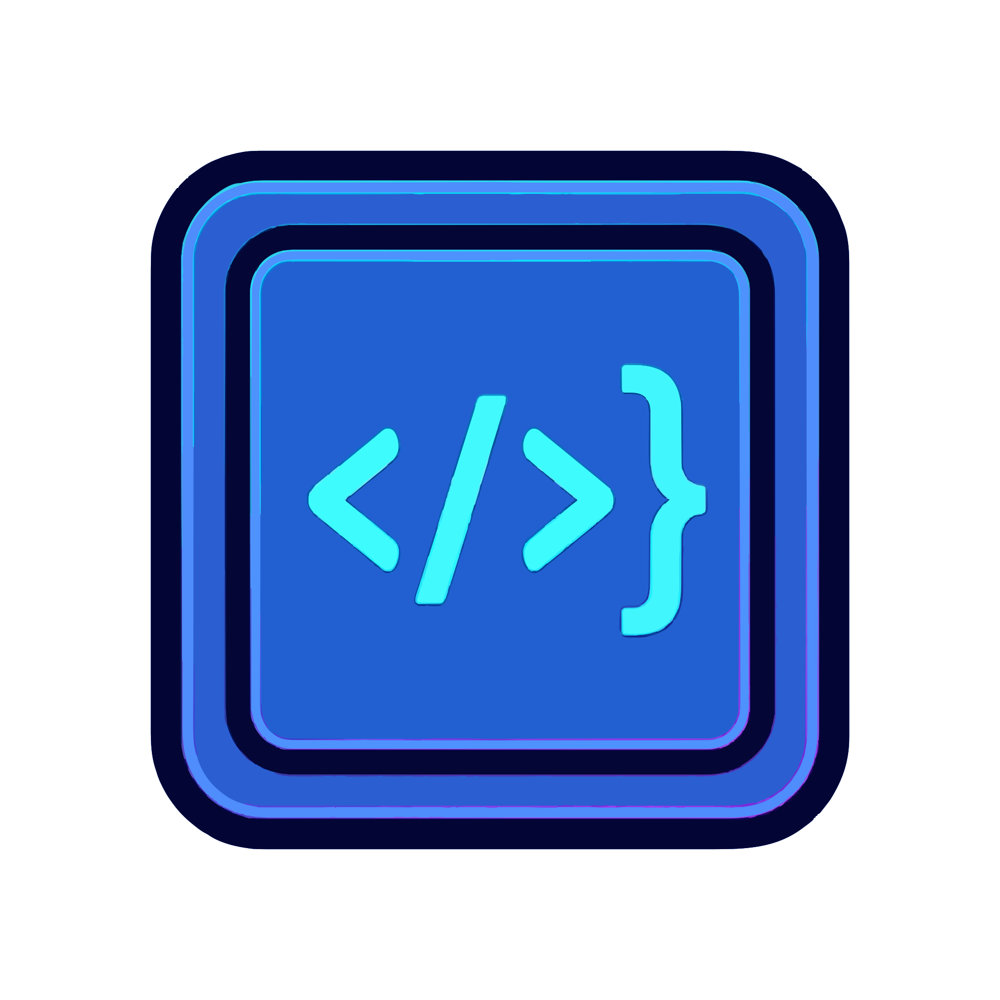

# ⚡ SnippetVault

<p align="center">
  
</p>

<p align="center">
  <strong>Современный self-hosted менеджер фрагментов кода (сниппетов) для разработчиков и команд.</strong>
</p>

<p align="center">
  
  
  
  
  
</p>

---

## 🌟 Ключевые возможности

### ⚡ Синхронизация в реальном времени (Real-Time Live Sync)
- **Мгновенное обновление без перезагрузки**: Изменения сниппетов, коллекций и тегов отображаются на всех открытых вкладках и устройствах в режиме реального времени (Linear / Notion-like live sync).
- **Server-Sent Events (SSE) + BroadcastChannel**: Архитектура на основе SSE-стрима (`/api/sync`) с фоновым обменом между вкладками браузера и автоматическим возобновлением при фокусе окна.
- **Интеллектуальный индикатор сети**: Пульсирующая точка в плашке версии показывает текущий статус подключения:
  - 🟢 **Зеленый** — соединение активно, данные синхронизируются в реальном времени.
  - 🟡 **Желтый** — повторное подключение / временные задержки сети.
  - 🔴 **Красный** — соединение разорвано / автономный режим (офлайн).

### 🌳 Иерархические папки и Умные коллекции
- **Дерево папок любой глубины**: Организация сниппетов в многоуровневую структуру каталогов (например, `Backend / Services / Auth`), сворачивание/разворачивание узлов, хлебные крошки и каскадное перемещение.
- **Умные коллекции (Smart Collections)**: Динамические виртуальные папки с настраиваемыми правилами («Создано за последние 7 дней», «Все Python-сниппеты с тегом #api», «Без тегов», «Только избранные») и живыми счетчиками элементов.
- **Кастомизация**: Назначение персональных цветов и иконок для любой папки.

### 🔍 Полнотекстовый поиск FTS5 (SQLite Full-Text Search)
- Быстрая индексация исходного кода, названий, заметок и тегов на уровне ядра SQLite.
- Ранжирование совпадений по релевантности.
- Точная подсветка найденного фрагмента прямо в карточке сниппета с отображением номера строки (`строка N`).

### 🔌 Интеграция с VS Code и экосистема разработчика
- **Официальное расширение для Visual Studio Code** (`extensions/vscode/`):
  - Быстрая вставка сниппетов в активный редактор по `Ctrl+Alt+V` (`Cmd+Alt+V`) с поиском по библиотеке.
  - Сохранение выделенного фрагмента кода в SnippetVault в 1 клик по `Ctrl+Alt+S` (`Cmd+Alt+S`) или через контекстное меню.
  - Автоматическое определение языка, имени файла и заголовка.
- **Персональные токены доступа (PAT / API ключи)**:
  - Генерация токенов доступа (`sv_pat_...`) с SHA-256 хешированием и ролями (`Только чтение` / `Чтение и запись`).
  - Поддержка авторизации через заголовок `Authorization: Bearer <TOKEN>` или `X-API-Key: <TOKEN>`.
- **Прямой Raw-эндпоинт**:
  - Мгновенное получение чистого кода любого файла по ссылке для шеринга:
    ```bash
    curl -sL https://vault.local/s/SHARE_TOKEN/raw/install.sh | bash
    ```
- **Центр интеграций**:
  - Отдельная вкладка «Интеграция» в настройках со статусом активности, управлением токенами и детальным журналом запросов API в реальном времени (IP-клиента, User-Agent, статус ответа, время).

### 🛡️ Панель администратора
- **Вкладка «Система»**: Метрики состояния базы данных, размер файлов на диске, проверка статуса WAL-журналирования, сжатие и дефрагментация базы (VACUUM) в 1 клик, ручное создание бэкапа.
- **Вкладка «Контент»**: Глобальный каталог всех сниппетов системы, фильтрация по авторам, модерация и безопасная передача сниппетов между пользователями (например, при смене ролей или увольнении сотрудника).
- **Вкладка «Теги»**: Управление тегами системы — слияние дубликатов тегов, пакетное переименование и удаление неиспользуемых.
- **Вкладка «Журнал аудита»**: Полный журнал событий безопасности (входы, сброс паролей, изменение ролей, блокировка аккаунтов, вызовы API) с фильтрацией и экспортом в JSON / CSV.
- **Глобальный контроль токенов**: Администратор видит все токены доступа пользователей, может отзывать скомпрометированные ключи или создавать новые токены от имени пользователя.
- **Управление сессиями**: Принудительный сброс всех активных сессий пользователя (force logout) по кнопке `Сессии`.

### 💾 Умный экспорт и импорт базы
- **Полный бэкап всей базы в JSON**: Экспорт сохраняет полную иерархическую структуру папок любой вложенности, умные коллекции со всеми правилами фильтрации и метаданные сниппетов.
- **Экспорт выбранной коллекции**: Выгрузка конкретной папки **вместе со всеми её дочерними подпапками и входящими в них сниппетами**.
- **Топологический импорт**: Алгоритм воссоздает дерево папок уровень за уровнем (`Parent -> Child -> Grandchild`) и распределяет сниппеты в их точные папки по хлебным крошкам (`collectionPath`).

### 📂 Мультифайловые сниппеты и CodeMirror 6
- Поддержка нескольких файлов в одном сниппете (например, `docker-compose.yml`, `.env`, `nginx.conf`).
- Полноценный встроенный редактор **CodeMirror 6** с подсветкой синтаксиса на лету (30+ языков).
- Номера строк, свертка блоков кода (folding), парные скобки, умные отступы и сохранение по `Ctrl+S`.
- Описание сниппета с поддержкой **GitHub Flavored Markdown** (таблицы, списки задач, форматирование).

### 📜 История версий (Revisions & Git-like Diff)
- Автоматическое сохранение снимков при каждом редактировании.
- Наглядное сравнение версий (Diff с добавленными и удаленными строками) и откат к любой предыдущей версии в 1 клик.

### ⚡ Песочница запуска кода (Playground)
- Запуск JS/TS в изолированном контексте с выводом в виртуальную консоль.
- Живое интерактивное веб-превью для HTML/CSS/JS.
- Выполнение Python прямо в браузере через WebAssembly (**Pyodide**).

### 🤖 Встроенный AI-ассистент
- Функции анализа: «Объяснить код», «Рефакторинг», «Документировать».
- Автоматическая генерация названий, описаний и тегов по коду.
- Поддержка OpenAI, Google Gemini, локальных LLM (Ollama, LM Studio).
- Поддержка прямого проксирования через HTTP / SOCKS5 в настройках UI (для стабильной работы из РФ).
- Встроенная кнопка проверки подключения к AI.

### 🔒 Безопасность и аккаунты
- Биометрический вход через **Passkeys (WebAuthn)** (Touch ID, Face ID, Windows Hello).
- Двухфакторная аутентификация (**2FA / TOTP**).
- Безопасный шеринг сниппетов по приватным ссылкам с токенами.
- Публичная регистрация отключена — создание пользователей производится администратором.

### 🌐 Мультиязычность и адаптивность
- Полная локализация на **русский** и **английский** языки (RU / EN).
- Быстрая командная палитра через `Ctrl+K` (`Cmd+K`).
- Клик по логотипу в шапке моментально сбрасывает фильтры и возвращает в раздел «Все сниппеты».
- Адаптивный мобильный интерфейс и стильная темная тема.

---

## 🚀 Варианты развертывания

### 1. Запуск через Docker

#### Быстрый старт (`docker run`):

```bash
docker run -d \
  --name snippetvault \
  --restart unless-stopped \
  -p 3000:3000 \
  -v $(pwd)/data:/app/data \
  kepler61b/snippet-vault:latest
```

> **Совет**: Для использования версии `0.8.0` в ветке разработки укажите тег `kepler61b/snippet-vault:0.8.0-dev` или `kepler61b/snippet-vault:dev`.

---

#### Запуск через `docker-compose.yml`:

```yaml
services:
  snippetvault:
    image: kepler61b/snippet-vault:latest
    container_name: snippetvault
    restart: unless-stopped
    ports:
      - "3000:3000"
    environment:
      - DATABASE_URL=file:/app/data/snippetvault.db
      - PORT=3000
      - HOSTNAME=0.0.0.0
      # Опционально: предустановка ключа AI
      # - AI_PROVIDER=openai
      # - AI_API_KEY=your_key_here
      # - AI_MODEL=gpt-4o-mini
    volumes:
      # Постоянное хранилище базы SQLite
      - ./data:/app/data
    healthcheck:
      test: ["CMD-SHELL", "wget --no-verbose --tries=1 --spider http://127.0.0.1:3000/ || exit 1"]
      interval: 20s
      timeout: 5s
      retries: 3
      start_period: 15s
```

Запуск:
```bash
docker compose up -d
```

---

### 2. Развертывание на Synology NAS (Container Manager / DSM 7.2+)

1. **Создайте каталог для базы данных**:
   - В приложении **File Station** внутри папки `docker` создайте путь:
     ```text
     /docker/snippetvault/data
     ```
2. **Создайте проект в Container Manager**:
   - Перейдите в **Container Manager** ➔ **«Проект» (Project)** ➔ **«Создать» (Create)**.
   - **Имя проекта**: `snippetvault`
   - **Путь**: укажите папку `/docker/snippetvault`
   - **Источник**: выберите *«Создать файл docker-compose.yaml»* и вставьте конфигурацию из примера выше (при необходимости измените внешний порт, например `8585:3000`).
3. Нажмите **«Далее»**, отметьте чекбокс **«Запустить проект после сборки»** и примените настройки.
4. Откройте сервис в браузере: `http://<IP_вашего_NAS>:3000`.

Подробное пошаговое руководство с иллюстрациями доступно в файле [SYNOLOGY_DEPLOY.md](SYNOLOGY_DEPLOY.md).

---

### 3. Локальный запуск для разработки (Node.js)

Требования: **Node.js 20+**, **npm**.

```bash
# 1. Клонируйте репозиторий
git clone https://github.com/kepler61b/snippet-vault.git
cd snippet-vault

# 2. Установите зависимости
npm install

# 3. Инициализируйте схему базы данных SQLite
npx prisma db push

# 4. Запустите сервер разработки
npm run dev
```

Приложение будет доступно по адресу: **http://localhost:3000**

---

## 🧩 Подключение расширения для Visual Studio Code

Расширение поставляется в каталоге `extensions/vscode/`.

1. **Получите токен доступа (PAT)**:
   - В веб-интерфейсе SnippetVault откройте **Параметры ➔ Интеграция**.
   - В блоке **«Персональные токены доступа (PAT)»** нажмите **«Создать токен»**.
   - Задайте имя (например, `VS Code Laptop`), выберите права (`Чтение и запись`) и скопируйте сгенерированный токен `sv_pat_...`.
2. **Установите расширение в VS Code**:
   - Скомпилируйте или используйте готовый файл `vscode-snippetvault-0.1.0.vsix` из папки `extensions/vscode/`:
     ```bash
     code --install-extension extensions/vscode/vscode-snippetvault-0.1.0.vsix
     ```
     *(или в VS Code: меню «Extensions» ➔ «...» ➔ «Install from VSIX...»)*.
3. **Подключите расширение к серверу**:
   - Откройте палитру команд в VS Code (`Ctrl+Shift+P` / `Cmd+Shift+P`).
   - Выберите команду:
     ```text
     SnippetVault: Configure Server URL & Token
     ```
   - Укажите URL вашего хранилища (например, `http://localhost:3000` или внешний домен) и вставьте токен PAT.

### Горячие клавиши в редакторе:
- **`Ctrl + Alt + V`** (`Cmd + Alt + V` на macOS) — поиск и быстрая вставка сниппета в позицию курсора.
- **`Ctrl + Alt + S`** (`Cmd + Alt + S` на macOS) — сохранение выделенного кода в SnippetVault в 1 клик.

---

## 🔑 Первый вход в систему

При первом запуске на чистой базе данных отображается подсказка для входа локального администратора:
- **Логин**: `admin@snippetvault.local`
- **Пароль**: `admin12345`

После входа создайте собственного администратора в **Панели управления** и измените пароль стандартного аккаунта. При появлении в базе дополнительных пользователей подсказка на экране авторизации автоматически скрывается.

---

## ⚙️ Переменные окружения

| Переменная | По умолчанию | Описание |
| :--- | :--- | :--- |
| `PORT` | `3000` | Порт HTTP-сервера |
| `HOSTNAME` | `0.0.0.0` | Сетевой интерфейс для прослушивания |
| `DATABASE_URL` | `file:/app/data/snippetvault.db` | Путь к файлу базы данных SQLite |
| `JWT_SECRET` | *(auto-generated)* | Секретный ключ для подписи сессионных JWT токенов |
| `NEXT_PUBLIC_APP_ENV` | `prod` | Режим работы (`prod` или `dev`) |
| `NEXT_PUBLIC_APP_VERSION` | `0.8.0` | Отображаемая версия приложения |
| `NODE_TLS_REJECT_UNAUTHORIZED` | `1` | Проверка TLS сертификатов при вызове AI API (`0` для самоподписанных) |
| `AI_PROVIDER` | `openai` | Провайдер AI по умолчанию (`openai`, `gemini`, `custom`) |
| `AI_API_KEY` | — | Ключ доступа к AI API |
| `AI_BASE_URL` | `https://api.openai.com/v1` | URL эндпоинта AI API |
| `AI_MODEL` | `gpt-4o-mini` | Модель AI для анализа кода |
| `AI_PROXY_URL` | — | HTTP / SOCKS5 прокси для обращений к AI (например, `socks5://127.0.0.1:1080`) |

---

## 📜 Лицензия

Проект распространяется под открытой лицензией [MIT](LICENSE).
Автор: [Kepler61b](https://github.com/Kepler61b).
